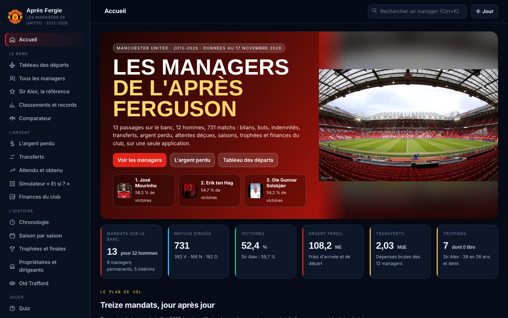
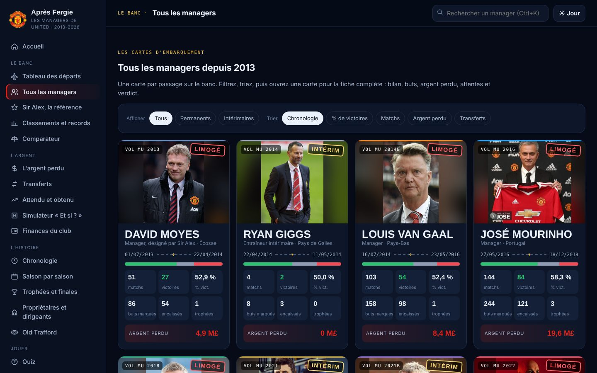
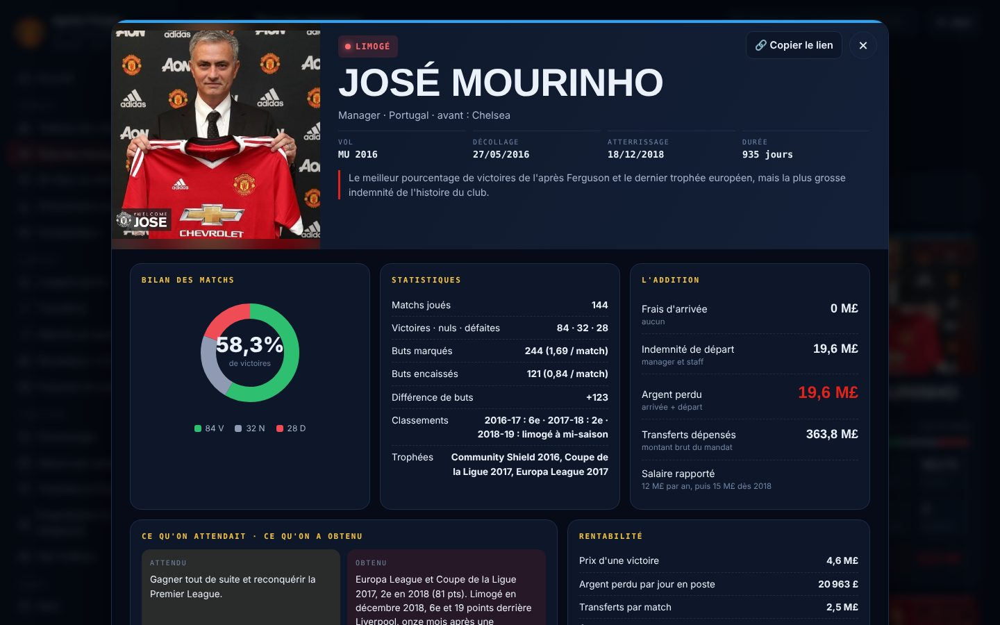
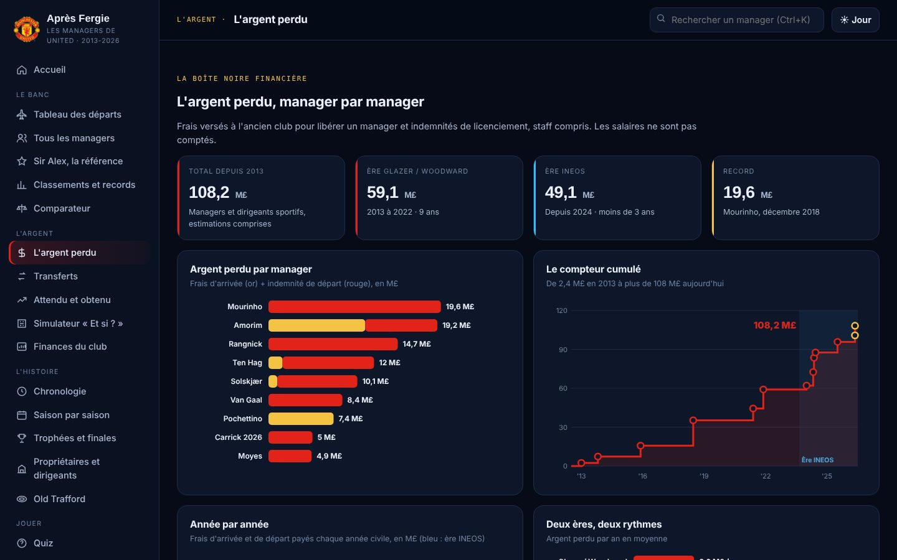
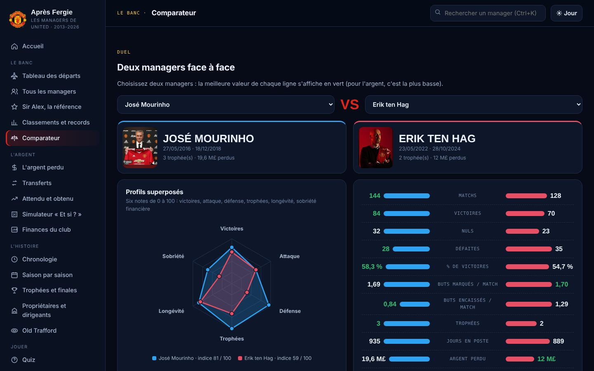
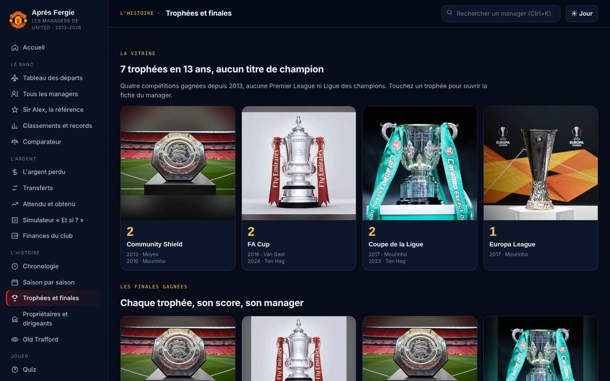
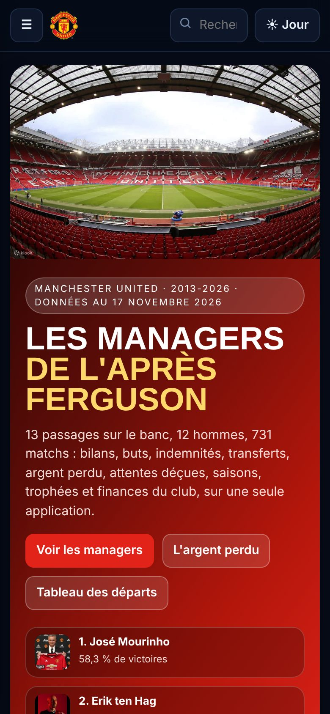

# ⚽ Manchester United · Les Managers de l'après Ferguson

**Treize mandats, douze hommes, 731 matchs et 108,2 M£ envolés depuis la retraite de Sir Alex Ferguson.**
Une application interactive qui raconte, chiffres à l'appui, tout ce qui s'est passé sur le banc d'Old Trafford de mai 2013 à novembre 2026 : bilans, buts, indemnités, transferts, attentes déçues, saisons, trophées et finances du club.

👉 **Ouvrir l'application : https://abdoulhamiddiallo.github.io/manchester-united-managers/**

---

## 🖥️ Aperçu de l'application

| Tous les managers | Fiche d'un manager |
|---|---|
|  |  |

| L'argent perdu | Comparateur |
|---|---|
|  |  |

| Trophées et finales | Format téléphone |
|---|---|
|  |  |

---

## 📊 Résultats clés

| Indicateur | Valeur |
|---|---|
| Mandats sur le banc depuis 2013 | **13**, pour 12 hommes (8 managers permanents, 5 intérims) |
| Matchs dirigés | **731** (383 victoires, 52,4 %) |
| Pourcentage de victoires de Sir Alex Ferguson | **59,7 %** sur 1 500 matchs |
| Frais d'arrivée et de départ (managers et dirigeants) | **108,2 M£** |
| Transferts dépensés par les 12 managers | **2,03 Md£** |
| Trophées gagnés depuis 2013 | **7**, dont aucun titre de champion |
| Plus grosse indemnité | **19,6 M£**, José Mourinho (décembre 2018) |
| Plus gros budget de transferts | **555,6 M£**, Erik ten Hag |
| Meilleur pourcentage de victoires (permanents) | **58,3 %**, José Mourinho |

---

## 💼 Ce que l'application met en lumière

- **Le coût réel de l'instabilité** : chaque limogeage, chaque rachat de manager à un autre club, chiffré et daté, avec le compteur cumulé depuis 2013.
- **Deux ères comparées** : 59,1 M£ perdus en neuf ans sous Glazer et Woodward, 49,1 M£ en moins de trois ans sous INEOS.
- **Dépenser n'est pas gagner** : Ten Hag a dépensé 1,5 fois le budget de Mourinho pour un taux de victoires inférieur ; Amorim a engagé 277 M£ pour 38,1 % de victoires.
- **Les attentes face aux résultats** : pour chaque manager, l'objectif fixé à son arrivée et les classements réellement obtenus.

---

## 🧭 Synthèse

L'application est organisée comme un tableau de bord d'aéroport, en 18 rubriques regroupées en quatre parties :

**Le banc**
- **Accueil** : chiffres clés animés, podium, machine à remonter le temps (un curseur de juillet 2013 à aujourd'hui qui montre le manager en poste, l'argent déjà perdu et les trophées à la date choisie), frise des mandats, records et vitrine des trophées.
- **Tableau des départs** : chaque mandat présenté comme un vol, avec des lettres qui défilent comme sur un panneau d'aéroport.
- **Tous les managers** : une carte d'embarquement par manager, avec filtres et tris ; chaque fiche détaille le bilan, les buts, l'addition, l'objectif face au résultat, la rentabilité, la vitrine, le profil radar et les recrues.
- **Sir Alex, la référence** : chaque successeur comparé aux 59,7 % de victoires et aux 1,85 but par match de Sir Alex.
- **Classements et records** : dix classements et un tableau complet triable.
- **Comparateur** : deux managers face à face, radars superposés et verdict.

**L'argent**
- **L'argent perdu** : par manager, en cumul, année par année, par ère, avec le relevé ligne par ligne.
- **Transferts** : dépenses par manager, coût par match et les 21 recrues les plus chères.
- **Attendu et obtenu** : objectif face aux classements, dépenses face aux victoires, prix d'une victoire.
- **Simulateur « Et si ? »** : on coche les limogeages qui n'auraient pas eu lieu et l'application calcule l'argent économisé et ses équivalents.
- **Finances du club** : chiffre d'affaires et résultat net de 2013 à 2026.

**L'histoire**
- **Chronologie** filtrable, **saison par saison**, **trophées et finales** (7 gagnées, 4 perdues), **propriétaires et dirigeants**, **Old Trafford**.

**Jouer**
- **Quiz** de dix questions et page **sources et méthode**.

---

## 🔄 Chaîne de traitement des données

1. **Collecte** : bilans officiels toutes compétitions, comptes annuels de Manchester United plc, décomptes des indemnités (The Telegraph, Associated Press, Sports Illustrated), dépenses de transferts (FourFourTwo, Sporting Intelligence, Sky Sports), actualité de novembre 2026 (Reuters, beIN Sports, Sports Mole).
2. **Recoupement** : chaque chiffre est vérifié sur au moins deux sources ; les montants non confirmés par le club sont signalés « ESTIM. » dans l'application.
3. **Modélisation** : une table des mandats (dates, matchs, buts, coûts, transferts, objectifs), une table des coûts datés, une table des saisons, une table des exercices financiers, une table des trophées et des finales.
4. **Calculs** : pourcentage de victoires, buts par match, argent perdu par jour en poste, prix d'une victoire, indice global sur six axes, cumul par ère.
5. **Restitution** : graphiques interactifs, classements, comparateur, simulateur et quiz.

---

## 🧬 Traçabilité des chiffres

| Donnée affichée | Calcul | Source |
|---|---|---|
| Argent perdu d'un manager | frais d'arrivée + indemnité de départ, staff compris | Comptes du club, The Telegraph, AP |
| Prix d'une victoire | (transferts + argent perdu) ÷ victoires | Calcul de l'application |
| Indice global | moyenne de six notes de 0 à 100 (victoires, attaque, défense, trophées, longévité, sobriété) | Calcul de l'application |
| Classement par saison | classement final de Premier League | Premier League, Opta |
| Chiffre d'affaires et résultat net | exercice clos au 30 juin | Manchester United plc |

---

## 🏗️ Architecture

- **Une seule page HTML autonome** : données, styles, scripts, photos et graphiques réunis dans `index.html`, sans serveur ni base de données.
- **Navigation par rubriques** avec barre latérale, recherche de manager (Ctrl+K), lien direct vers chaque fiche (`#fiche-mourinho`) et navigation au clavier.
- **Graphiques en SVG dessinés à la main** : frise de Gantt, compteur cumulé, courbe de classement, nuage de points, radars, barres empilées, haltères objectif et résultat.
- **Thème jour et nuit**, mémorisé dans le navigateur.
- **Format téléphone soigné** : menu escamotable, tableaux adaptés, aucun texte qui se chevauche (contrôle automatique sur quatre tailles d'écran).

---

## 🛠️ Technologies

- HTML5, CSS3 (grilles, variables de thème, `color-mix`), JavaScript sans bibliothèque
- SVG pour tous les graphiques
- Polices Google : Inter, Sora, Barlow Condensed, JetBrains Mono
- GitHub Pages pour la mise en ligne

---

## ✅ Conclusion

Depuis mai 2013, Manchester United a changé de banc treize fois, dépensé plus de deux milliards de livres en transferts et perdu plus de cent millions en arrivées et départs de managers et de dirigeants, pour sept trophées et aucun titre de champion. L'application met ces chiffres côte à côte pour que chacun puisse juger, manager par manager, ce que chaque décision a coûté et rapporté.

---

## 💡 Le mot de la fin

Construire pour explorer. Explorer pour comprendre. Et apprendre en chemin.

**Abdoul Hamid Diallo** · Microsoft Fabric Data Engineer
[LinkedIn](https://www.linkedin.com/in/abdoul-hamid-diallo-fabric-data-engineer/) · [Toutes mes applications](https://abdoulhamiddiallo.github.io/)
